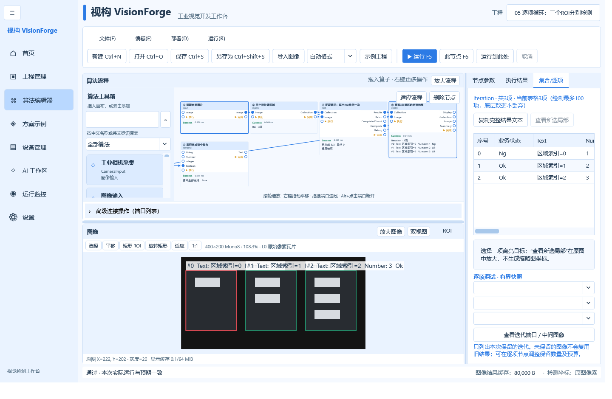

# 视构 VisionForge

[Read in English](#english) · [源码快照](source/) · [许可证](source/licenses/) · [快速开始](docs/quick-start.md) · [开发者接入](docs/integration.md) · [AI 辅助写算法](docs/ai-assisted-development.md) · [0.6.3 发行资料](release-info/v0.6.3/) · [发行下载](https://github.com/martinmack233/VisionForge/releases)

视构是一款面向 **Windows 11 x64** 的工业视觉工作台。用可视化节点编排图像采集、预处理、定位、测量、检测和结果输出。算法流程可以在桌面调试，也可以交给 Console、RuntimeHost 或 .NET 程序执行。

公开源码现已加入「图像滤波」和「轮廓包围几何」。支持多方式 ROI 滤波、Float32 方框邻域和、外接矩形与旋转矩形、最小外接圆及基于二值掩膜的像素近似最大内接圆。从当前快照构建后，可在「方案示例」运行两份合成工程。[参数、端口与示例说明](source/docs/0.6.4-滤波与轮廓几何.md)

## 可用功能和特点

| 能力 | 能做什么 |
|---|---|
| 可视化流程 | 带类型的节点端口、拖拽连线、参数编辑、单次执行和输出检查。支持流程分支、节点禁用与撤销，还能把参数和资源打包成便携工程。 |
| 传统视觉 | 灰度与颜色处理、滤波、阈值、形态学、边缘和有符号梯度、轮廓、Blob、模板定位、卡尺与几何测量。 |
| ROI 与图像变换 | 矩形及旋转裁切、ROI 跟随和局部预览，支持仿射与透视映射。裁切坐标和原图坐标可以按变换显式关联。 |
| 集合与逐项子流程 | 筛选、排序或索引选择目标。用 ForEach 对每个 ROI 或集合项重复同一子流程，查看每一项的数值、状态及原图关联。 |
| 识别与结果显示 | 英文 OCR、条码、二维码，图像叠加、文本、布尔和结果表格。执行状态与业务 OK/NG 分开显示。 |
| 图像来源 | 可读离线图片和文件夹虚拟相机。博峤相机通过选配的厂商 SDK 和驱动配置，实体相机需要现场验收。 |
| 工程部署 | 工程可保存、复制及导入导出。便携项目包记录依赖和哈希，模型默认保留外部引用，机器配置与工程资源分别管理。 |

传统视觉、英文 OCR 和文件夹虚拟相机可以离线使用。核心包随附 .NET 10.0.15，自带的示例可用合成图片练习，无需真实相机或外部模型。

## SDK / 开发接口

| 接入方式 | 适合 |
|---|---|
| **Console** | 从脚本或其他程序执行本地工程、指定目标节点和导出结果。 |
| **RuntimeHost** | 从上位机通过 TCP/JSON 加载工程、发起运行、查询状态、取结果及取消。支持 `--once` 单次运行。 |
| **.NET C# 接口** | 使用发行包中的 `VisionPlatform.Contracts.dll`、Runtime 等组件做同进程集成。用 `IExecutableNode` 开发自定义算法，将可信 DLL 显式加载到 RuntimeHost。 |

这里的 SDK 指随版本提供的 .NET 开发接口与宿主。接入时使用同版本依赖。示例演示了从灰度图统计亮像素占比并输出实际数值。[开发者接入指南](docs/integration.md) · [可编译 C# 算子示例](examples/dotnet-brightness/)

## YOLO 与 AI 工作区

- **模型训练工作流**支持在已配置的 YOLOStudio 环境中管理数据集、图片标注、线扫切片、训练、评估及模型部署。配置向导提供环境检查，训练由用户启动。
- **部署推理**使用 ONNX CPU 后端，可按工程会话复用模型。部署需准备兼容的 ONNX 模型、对应部署契约和 Python 组件，模型与环境按需配置。
- **混合检测**可在同一流程中组合传统定位、裁切和 AI 推理，再用集合整理结果并输出业务判断。[配置与接入](docs/integration.md#yolo)

## 工业通信

| 接口 | 当前能力 |
|---|---|
| TCP/IP | 客户端与服务端，文本及二进制消息，连接、监听、发送、接收和请求响应。 |
| 串口 | 按设备配置端口和串口参数，使用独立会话执行通信。 |
| Modbus TCP / RTU | TCP 客户端和 RTU 主站、线圈和寄存器读写、寄存器解码以及字节序/字序配置。 |
| 上位机控制 | RuntimeHost 自有 TCP/JSON 工程控制协议，与流程内发送业务消息的 TCP 节点分别使用。 |

正式验收覆盖本机 TCP、Modbus TCP 与 RTU 协议模拟。实体串口、PLC 和真实产线接入需要现场验证。[通信及调用说明](docs/integration.md#communication)

## AI 辅助写算法

可以把检测目标、输入输出、阈值和预期结果交给外部 AI 编程助手，请它先设计节点流程，或起草实现 `IExecutableNode` 的 C# 算子。审核并编译代码后，用 RuntimeHost 在离线样例上验证，再接入自己的业务流程。

当前提供的是可供外部 AI 辅助开发的契约、工程格式和调用入口。桌面端尚无内置对话生成并自动执行算法的功能。[工作流程与提示词示例](docs/ai-assisted-development.md)

## 开始使用

1. 从 [Releases](https://github.com/martinmack233/VisionForge/releases) 获取 Windows x64 ZIP，完整解压后启动 `VisionForge.exe`。
2. 从 **方案示例 → 从第1课开始 → 一键运行** 打开可编辑副本。
3. 看图像与文字输出，再练习矩形裁切、旋转裁切、集合筛选选择和多 ROI 循环。[快速开始与截图](docs/quick-start.md)

0.6.3 正式构建通过 850 项自动化测试，公开包解压后通过 25 个 Console 和 RuntimeHost 离线示例。桌面端验证了五个新手案例及保存重开。公开仓库提供 0.6.3 源码快照、使用文档、接入示例及发行资料。下载包内的 `component-manifest.json` 和 `licenses` 提供第三方组件和许可信息。

---

## English

[Source snapshot](source/) · [License notices](source/licenses/) · [Quick start](docs/quick-start.md) · [Developer integration](docs/integration.md) · [AI-assisted development](docs/ai-assisted-development.md) · [0.6.3 release information](release-info/v0.6.3/) · [Release downloads](https://github.com/martinmack233/VisionForge/releases)

VisionForge is an industrial machine vision workbench for **Windows 11 x64**. Its visual editor lets you connect acquisition, preprocessing, alignment, measurement, inspection, and result output. You can debug a workflow in the desktop app and run it through Console, RuntimeHost, or a .NET application.

The public source snapshot now includes `ImageFilter` and `ContourEnvelope`. They cover ROI filtering, Float32 neighborhood sums, upright and rotated bounding rectangles, minimum enclosing circles, and mask-based approximate largest inscribed circles. Build the current snapshot to run the two synthetic examples from Example Projects. [Operator and example guide](source/docs/0.6.4-滤波与轮廓几何.md)

### Features

| Area | Capabilities |
|---|---|
| Visual workflows | Typed node ports, drag-and-drop wiring, editable parameters, individual runs, and output inspection. Supports branching, disabling nodes, undo, and portable project packages. |
| Classical vision | Grayscale and color operations, filtering, thresholding, morphology, edges and signed gradients, contours, blobs, template matching, calipers, and geometric measurements. |
| ROI and geometry | Rectangular and rotated crops, ROI tracking, local previews, affine and perspective transforms, and explicit mapping back to source-image coordinates. |
| Collections and subflows | Filter, sort, or select detections by index. Use ForEach to run a subflow per ROI or item and inspect its values, status, and source regions. |
| Recognition and display | English OCR, barcodes, QR codes, image overlays, text, Booleans, and result tables. Execution state and the inspection decision are shown separately. |
| Image acquisition | Offline images, a folder-based virtual camera, and an optional Boq camera adapter. Physical cameras require vendor software and on-site testing. |
| Deployment | Save or copy projects and import or export packages with dependency and hash checks. Models are external references by default, and machine settings stay separate. |

Core offline inspection runs without external models or a physical camera. The Windows package includes .NET 10.0.15 and five guided lessons using synthetic images.

### SDK and developer integration

**Console** executes local projects from a script, with support for selecting a target node and exporting outputs. **RuntimeHost** provides a TCP/JSON interface for loading and running projects, polling status, retrieving results, and cancelling runs. It also supports a one-shot mode. The **.NET interfaces** shipped with the same release allow in-process integration, and `IExecutableNode` is the extension point for algorithm plugins. RuntimeHost explicitly loads trusted plugin DLLs. [Integration guide](docs/integration.md) · [Buildable C# plugin example](examples/dotnet-brightness/)

### YOLO and the AI workspace

The optional YOLOStudio-backed workspace supports dataset management, annotation, line-scan image tiling, training, evaluation, and deployment. Inspection nodes run ONNX inference on CPU and can reuse a model within a project session. Configure the compatible model, deployment contract, and Python component for your machine. Combine AI inference with classical vision and collection operations in a single inspection workflow. [YOLO setup](docs/integration.md#yolo)

### Communication

Workflow nodes support TCP client and server roles, text and binary messages, request/response, serial communication, and Modbus TCP and RTU. Modbus includes coil and register operations and configurable byte and word order for decoding. RuntimeHost exposes a separate TCP/JSON control protocol for supervisory applications. Validation covers loopback TCP and Modbus TCP plus RTU protocol simulation. Physical serial devices and PLCs require on-site testing. [Communication details](docs/integration.md#communication)

### AI-assisted algorithm development

An external coding assistant can help design a visual workflow, draft a C# implementation of `IExecutableNode`, and prepare test inputs and expected results. Review and compile the code, then run it with RuntimeHost on offline samples. The desktop app currently provides the execution and plugin interfaces for this workflow. Built-in conversational code generation and automatic execution are outside the current feature set. [Workflow and prompt example](docs/ai-assisted-development.md)

### Get started

Download the Windows x64 ZIP from [Releases](https://github.com/martinmack233/VisionForge/releases), extract the full directory, and run `VisionForge.exe`. Open **Examples → Start with Lesson 1 → Run** to create an editable project copy and inspect the results. [Quick start with screenshots](docs/quick-start.md)

The 0.6.3 build passed 850 automated tests. The extracted public package was checked with 25 Console and RuntimeHost offline examples. Desktop validation covered the five beginner projects and saving and reopening projects. Component and third-party notices ship in `component-manifest.json` and `licenses`.
