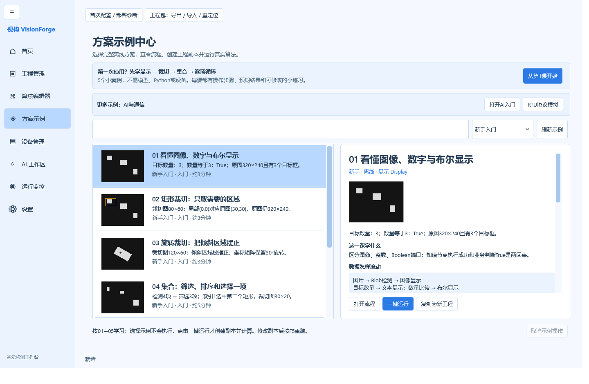

# 快速开始 | Quick start

在 [Releases](https://github.com/martinmack233/VisionForge/releases) 获取 Windows 11 x64 便携 ZIP。下载对应 SHA256，使用 `Get-FileHash -Algorithm SHA256` 核对文件。完整解压后运行 `VisionForge.exe`。程序自带 .NET 运行时。

Download the Windows 11 x64 portable ZIP from [Releases](https://github.com/martinmack233/VisionForge/releases). Verify it against the accompanying SHA256 file, extract the whole folder, and open `VisionForge.exe`. The .NET runtime is bundled.

1. 首次启动时打开部署向导，可选择“关闭，继续核心检测”。On first launch, use **Close and continue with core inspection** to proceed.
2. 打开 **方案示例 → 从第1课开始 → 一键运行**。Open **Examples → Start with Lesson 1 → Run**.
3. 点击节点和输出端口查看图像、数字或判定。修改参数后应用，再在当前副本按 F5 重跑。Select a node or output port to inspect its result. Apply parameter changes and press F5 to rerun the copy.

| 课程 | 预期输出 |
|---|---|
| 结果显示 / Result display | 图像叠加三个目标框 / Three targets shown as an overlay |
| 矩形裁切 / Rectangle crop | 局部图 80×60，坐标映射回原图 / 80×60 result with a source-coordinate transform |
| 旋转裁切 / Rotated crop | 裁出并摆正 120×60 图像 / Aligned 120×60 crop |
| 集合筛选 / Collection filtering | 4 个对象筛成 3 个，再按索引选出第 2 个 / Four items filtered to three, with the second selected |
| 逐项循环 / Per-item loop | 三个 ROI 分别输出 1、2、3 个目标 / The three ROIs yield counts of 1, 2, and 3 |

进阶使用见[开发者接入](integration.md)和[AI 辅助开发](ai-assisted-development.md)。
